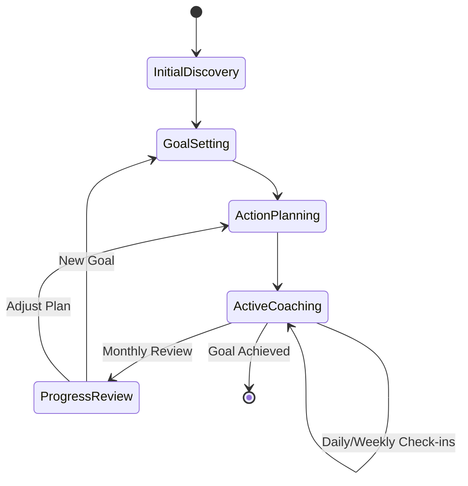
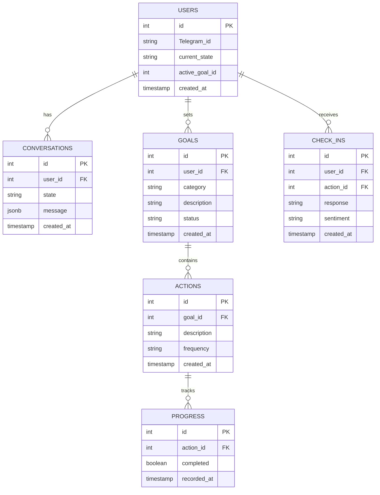

# Technical Specifications

## Implemented

<details>
  <summary><h3 style="display:inline-block">Hackathon POC</h3></summary>

### Core Modules

#### Message Handler

- Polls Telegram
- Processes incoming messages
- Manages response queue
- Handles threading

#### Conversation Manager

- Maintains conversation state
- Processes user inputs
- Manages context
- Dynamic responses generation by LLM

#### Integrations

- Telegram
- Groq

</details>

## Up Next

<details>
  <summary><h3 style="display:inline-block">Conversation Summarization & Memory Optimization</h3></summary>

### Goal

- Prevent performance issues by **limiting message history** while keeping key insights.
- Store **summaries of past conversations** to retain long-term context.

### Summary Trigger Rules

Summarization occurs when either condition is met:

1. **N messages exchanged** since the last summary.
2. ~~**N days have passed** since the last summary.~~

Reasoning:

- Users with **high message volume** get summarized frequently.
- ~~Users with **low engagement** still receive periodic summaries to prevent context loss.~~
- This approach is **simple, conservative, and easy to adjust later**.

### Summary Storage & Retrieval

- Summaries are stored in a separate `Summary` table.
- When sending context to the LLM, retrieve:
  - The **latest `N` messages** (raw history).
  - The **most recent summary**, but **exclude the latest `N` messages from it** to prevent redundancy.

### Database Schema

#### Message Table

_Formerly named the `Conversation` table._

| Column      | Type            | Description                        |
| ----------- | --------------- | ---------------------------------- |
| `id`        | UUID (PK)       | Unique identifier for each message |
| `user_id`   | UUID (FK)       | References `users` table           |
| `text`      | TEXT            | Message content                    |
| `role`      | ENUM(user, bot) | Who sent the message               |
| `timestamp` | TIMESTAMP       | When the message was sent          |

#### Summary Table

| Column       | Type      | Description                          |
| ------------ | --------- | ------------------------------------ |
| `id`         | UUID (PK) | Unique identifier for the summary    |
| `user_id`    | UUID (FK) | References `users` table             |
| `summary`    | TEXT      | AI-generated summary of past message |
| `created_at` | TIMESTAMP | When the summary was generated       |

</details>

<details>
  <summary><h3 style="display:inline-block">Proactive Coaching & Check-ins</h3></summary>

### Goal

- Ensure **tracked commitments** remain accessible (e.g., "User plans to meditate daily before bed which is around 10pm").
- Ensure users **stay accountable** with **habit-specific check-ins** (e.g. the next day they will be asked if they meditated the previous night).
- Allow the **AI to track repeated actions** and adjust coaching based on progress.
- Provide **flexibility** for users to manage check-in frequency or abandon a goal.

### Tracking Progress & Repeated Actions

This enables future features like:

- Adaptive coaching (suggesting easier actions if struggles continue).
- Visualizing progress (graphs, streaks, trends).
- Gamification (streak rewards, badges).

### Check-in Frequency Rules

- **Users specify check-in frequency**, guided by the coach.
- **Frequency must be within:**
  - **Max:** **2 times per day** (prevents spam).
  - **Min:** **Every 3 days** (ensures habits stay relevant).

**Example Habit-Based Check-in Frequencies:**  
| Habit Type | Suggested Frequency |
|------------|------------------|
| **Daily habits** (e.g., “Eat 20g of protein at breakfast”) | **Daily** |
| **Frequent habits** (e.g., “Drink water every hour while awake”) | **Multiple times per day** (up to 2 max) |
| **Scheduled habits** (e.g., “Exercise 3 times a week on Monday, Wednesday, Friday”) | **Every 2-3 days** |

**Edge Case Handling:**

- If a habit **doesn’t fit neatly**, default to **daily or every 3 days**.
- The coach should guide users in **selecting an appropriate frequency**.

### Handling Missed Check-ins

- If a user **doesn’t respond**, the coach will **continue at the same frequency**.
- If a user **misses 5 consecutive check-ins**, the AI will marked the goal as "abandoned" and stop checking in.
- If a user **proactively provides an update**, the next scheduled check-in **may be canceled**.
  - If a user sends an explicit progress update, cancel the next check-in. Otherwise, continue with next check-in.

### Adjusting Goals

- If a user fails X check-ins (e.g. after 5 check-in, complete rate less than 80%), the AI will **suggest adjusting the goal** to be more achievable.
  - AI will confirm with the user before adjusting the goal.
  - If adjusted, abandoned the current goal and create a new one.

### Completing a Goal

- Goals are considered completed when the goal's target end date is reached.

### Abandoning a Goal

- Users can abandon a goal and stop all its check-ins.

### Database Schema

#### Goals Table

| Column            | Type                               | Description                                     |
| ----------------- | ---------------------------------- | ----------------------------------------------- |
| `id`              | UUID (PK)                          | Unique identifier for goal                      |
| `user_id`         | UUID (FK)                          | References `users` table                        |
| `description`     | TEXT                               | Goal description (e.g., “Drink 2L water daily”) |
| `created_at`      | TIMESTAMP DEFAULT now()            | When the goal was created                       |
| `target_end_date` | TIMESTAMP                          | Target end date                                 |
| `actuaL_end_date` | TIMESTAMP                          | Actual end date (completed or abandoned)        |
| `frequency`       | ENUM(DAYS_1, DAYS_2, DAYS_3)       | How often to check in                           |
| `status`          | ENUM(ACTIVE, COMPLETED, ABANDONED) | Current goal status                             |

Status:

- Active: Ongoing check-ins and tracking.
- Completed: Reached target end date. Stop check-ins and tracking.
- Abandoned: Ended before target end date. Stop check-ins and tracking.

#### Check-ins Ledger Table

| Column          | Type                    | Description                         |
| --------------- | ----------------------- | ----------------------------------- |
| `id`            | UUID (PK)               | Unique identifier for check-in      |
| `user_id`       | UUID (FK)               | References `users` table            |
| `goal_id`       | UUID (FK)               | References `goals` table            |
| `created_at`    | TIMESTAMP DEFAULT now() | When the check-in was created       |
| `next_check_in` | TIMESTAMP               | When the next check-in will be sent |

#### Progress Tracking Ledger Table

| Column        | Type                            | Description                          |
| ------------- | ------------------------------- | ------------------------------------ |
| `id`          | UUID (PK)                       | Unique identifier for progress entry |
| `user_id`     | UUID (FK)                       | References `users` table             |
| `goal_id`     | UUID (FK)                       | References `goals` table             |
| `check_in_id` | UUID (FK)                       | References `check-ins` table         |
| `created_at`  | TIMESTAMP                       | When the progress was recorded       |
| `status`      | ENUM(COMPLETED, FAILED, MISSED) | Progress status                      |

Status:

- Completed: User response and notes goal action was completed.
- Failed: User response and notes goal action was not completed.
- Missed: User does not response, unable to track progress.

<details>
  <summary><h4 style="display:inline-block">Database ERD</h4></summary>
    ```mermaid
    erDiagram
        USER ||--o{ GOAL : has
        USER ||--o{ CHECK_IN : receives
        USER ||--o{ PROGRESS_TRACKING : logs

        GOAL ||--o{ CHECK_IN : schedules
        GOAL ||--o{ PROGRESS_TRACKING : tracks

        CHECK_IN ||--o{ PROGRESS_TRACKING : records

        USER {
            UUID id PK
            BIGINT telegram_id "Unique Telegram ID"
            TEXT username "Optional username"
            TIMESTAMP created_at "Account creation date"
        }

        GOAL {
            UUID id PK
            UUID user_id FK "References USER"
            TEXT description "Goal description"
            ENUM frequency "DAYS_1, DAYS_2, DAYS_3"
            TIMESTAMP created_at "When the goal was created"
            TIMESTAMP target_completion_date "Optional target completion date"
            TIMESTAMP actuaL_end_date "Optional end date"
            ENUM status "ACTIVE, COMPLETED, ABANDONED"
        }

        CHECK_IN_LEDGER {
            UUID id PK
            UUID user_id FK "References USER"
            UUID goal_id FK "References GOAL"
            TIMESTAMP next_check_in "When the next check-in is scheduled"
            TIMESTAMP created_at "When this check-in record was created"
        }

        PROGRESS_TRACKING_LEDGER {
            UUID id PK
            UUID user_id FK "References USER"
            UUID goal_id FK "References GOAL"
            UUID check_in_id FK "References CHECK_IN"
            TIMESTAMP date "When the progress was recorded"
            ENUM status "COMPLETED, FAILED, MISSED"
        }
      ```

</details>

### Integrating LLM with Goal/Check-In/Progress Tracking

#### How Does the System Know When to Create/Update Records?

The LLM will **detect intent** from user messages and response with to **structured** responses.

#### Approach: Using LLM for Intent Recognition\*\*

1. **User sends a message** → `"I want to start drinking more water"`
2. **LLM detects intent** → `"User wants to set a goal"`
3. **System extracts key details** → Goal: `"Drink water every hour"`
4. **System updates the database** → Creates a **goal record** in `goals` table.

**This means the LLM must be explicitly prompted to classify user intent.**

#### Key Actions the LLM Needs to Recognize\*\*

To update the database properly, the LLM must classify user messages into **one of these categories**:

| **Intent**                          | **Action Taken in Database**                             |
| ----------------------------------- | -------------------------------------------------------- |
| **Set a new goal**                  | Create a record in `goals`                               |
| **Modify goal**                     | Update the `goals` record                                |
| **Complete/abandon goal**           | Update `status` in `goals`                               |
| **Check-in response**               | Insert a record into `progress_tracking`                 |
| **User reports proactive progress** | Insert into `progress_tracking` and cancel next check-in |

### Server Implementation: CRON Job for Scheduled Check-ins

- The server will run a CRON job every hour to check for due check-ins and send reminder messages.

CRON Job Logic

1. Query check_ins table for next_check_in timestamps that are past due.
2. Send a check-in message to the user.
3. If the user responds, log it in progress_tracking and schedule the next check-in.
4. If no response after 5 check-ins, suggest adjusting the goal.
5. Update next_check_in based on frequency.

Why CRON?

- Simple to implement.
- Runs independently of the main app.

<details>
  <summary><h4 style="display:inline-block">End-to-End Flow Example</h4></summary>
    ```mermaid
    sequenceDiagram
      participant User
      participant Bot
      participant Database

      User->>Bot: I want to improve my sleep
      Bot->>User: What specific goal would you like to achieve?
      User->>Bot: Sleep 8 hours per night
      Bot->>Database: Store goal in `goals` table
      Database->>Bot: Goal saved

      Bot->>User: How often should I check in? (Max: twice per day, Min: every 3 days)
      User->>Bot: Daily
      Bot->>Database: Schedule check-ins in `check_ins_ledger` table
      Database->>Bot: Check-ins scheduled

      Note over User,Bot: Check-in Phase Begins

      Bot->>User: Did you sleep 8 hours last night?
      User->>Bot: Yes!
      Bot->>Database: Log progress as "completed" in `progress_tracking_ledger`

      Bot->>User: Great job! Keep it up!

      Note over User,Bot: If user misses 5 check-ins

      Bot->>User: You've missed a few check-ins. Would you like to adjust your goal?
      User->>Bot: Yes, let's try 7 hours instead
      Bot->>Database: Update `goals` table

      Bot->>User: Goal updated. I'll check in again soon!
    ```

</details>

</details>

<details>
  <summary><h3 style="display:inline-block">Error Handling</h3></summary>

```typescript
// Global error handler
process.on("unhandledRejection", (error: Error) => {
  console.error("Unhandled rejection:", error);
  // Implement error reporting
});

// Service-level error handling
class BaseService {
  protected async handleError(error: Error): Promise<void> {
    if (error instanceof TelegramApiError) {
      // Handle rate limits, retry
    } else if (error instanceof DatabaseError) {
      // Handle connection issues
    }
    // Log error
    throw error;
  }
}
```

</details>

## Archived

<details>
  <summary><h3 style="display:inline-block">Conversation State Machine</h3></summary>

States were used in a state machine pattern but were too rigid. Instead of explicitly tracking an user's "state", the LLM has been instructed to coach users while considering something similar.

1. Initial Discovery

- Personal background
- Current lifestyle
- Health priorities

2. Goal Setting

- Category selection
- Specific goal definition
- Timeline establishment

3. Action Planning

- Task definition
- Frequency setting
- Success criteria
- Guided by Habita

4. Active Coaching

- Regular check-ins
- Progress tracking
- Adjustments

5. Progress Review

- Achievement assessment
- Plan adjustment

### Conversation Flow



### Core Entities

1. Coach (Habita)

   - Bot identity
   - Coaching personality
   - Command handlers
   - Response patterns

2. Coachee

   - Telegram identity (userId, chatId)
   - Current goals
   - Progress metrics

3. Goals

   - Category
   - Specific targets
   - Timeline
   - Status and priority

4. Actions

   - Specific tasks
   - Frequency
   - Location if relevant (eg. HIIT workout at local gym)
   - Completion status

5. Check-ins
   - Scheduled time
   - Response tracking
   - Progress updates

</details>

<details>
    <summary><h3 style="display:inline-block">Initial ERD</h3></summary>

This was the initial ERD designed before implementation. Since implemenatation shifted to relying on the LLM these become less relevant but as we add more sophisticated we made need to revisit these entities.



</details>
